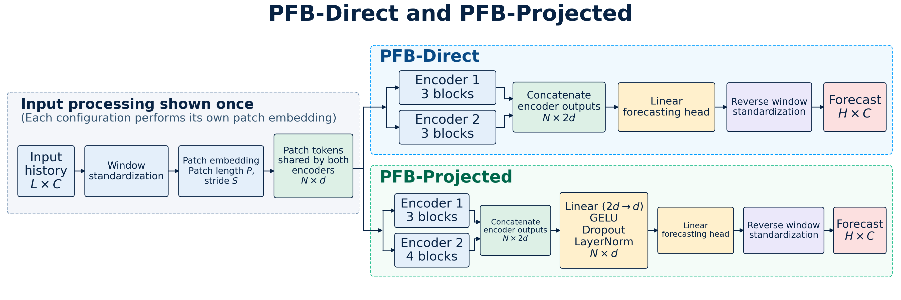

# Parallel Patch-Encoder Fusion (PFB)

**Long-horizon time-series forecasting with shared temporal patches and parallel encoders.**

[](#quick-start)
[](#quick-start)
[](LICENSE)
[](results_summary/README.md)

[Models](#models) · [Quick start](#quick-start) · [Experiments](#experiments) · [Results](#results-and-reproducibility) · [Citation](#citation)

PFB learns and fuses parallel transformations of the same temporal patches. This
repository provides PyTorch implementations of PFB-Direct and PFB-Projected,
comparison models, experiment runners, numerical results and scientific figures.
The experiments examine forecasting accuracy, architectural choices,
preprocessing, model selection and computational cost.

<p align="center">
  
</p>

## Models

| Model | Encoder structure | Fusion |
|---|---|---|
| **PatchTST** | Single patch encoder | Reference model |
| **PFB-Direct** | Two independently parameterized, jointly trained encoders | Concatenation |
| **PFB-Projected** | Two independently parameterized, jointly trained encoders | Concatenation, linear projection, GELU, dropout and layer normalization |

Comparisons include wider and deeper encoders, matched serial processing,
output ensembles, DLinear, iTransformer, TiDE, TimeXer and additional baselines.
PFB-Direct and PFB-Projected are trained as separate configurations.

## Quick start

Clone with long-path support for the retained experiment identifiers:

```powershell
git clone -c core.longpaths=true https://github.com/Hussein-Ahmad-Ahmad/pfb-forecasting.git
cd pfb-forecasting
python -m pip install -r requirements.txt
```

Use Python 3.10 with the base requirements file. The recorded RTX 4090
environment uses Python 3.12.10 and PyTorch 2.11.0+cu126. Full recorded versions
are listed in [PROVENANCE.json](results_summary/PROVENANCE.json).

Inspect the available controlled experiments:

```powershell
python scripts/paper/run_controlled_addons.py --help
```

Place dataset CSV files in `data/`, including `electricity.csv` and `traffic.csv`
for those benchmarks. Dataset filenames and settings are defined in the runners.
The code builds on [Time-Series-Library](https://github.com/thuml/Time-Series-Library).

## Experiments

| Study | Default scope | Runs |
|---|---|---:|
| Projected architectural controls | Three datasets, H=192, eleven configurations, five seeds | 165 |
| Validation-only HPO | Six datasets, seven model families, twelve distinct candidates | 504 |
| Locked HPO evaluation | Selected configurations, five independent test seeds | 210 |
| Paired normalization | Four datasets, four models, ON/OFF, five seeds | 160 |

### Controlled studies

Run the following sequentially after preparing the datasets:

```powershell
python scripts/paper/run_controlled_addons.py projected --execute --skip-completed
python scripts/paper/run_controlled_addons.py preprocessing --execute --skip-completed
python scripts/paper/run_controlled_addons.py hpo-select --execute --skip-completed
python scripts/paper/run_controlled_addons.py hpo-lock
python scripts/paper/run_controlled_addons.py hpo-test --execute --skip-completed
```

Training requires RTX 4090 CUDA execution. Omitting `--execute` prepares or
inspects the training plan. HPO uses equal candidate counts, while occupied
GPU-hours are recorded separately. See the [study protocol](experiments/controlled_addons/README.md)
for configurations, analysis and resumption rules.

### Benchmark and robustness studies

| Study | Runner |
|---|---|
| Electricity and Traffic | [Core benchmarks](experiments/core_benchmarks/run_expensive_core_5seed.py) |
| Additional datasets | [Candidate benchmarks](experiments/core_benchmarks/run_candidate_core_5seed.py) |
| Patch, stride and learning rate | [Targeted HPO](experiments/targeted_hpo/run_targeted_hpo.py) |
| Configuration sensitivity | [Secondary sensitivity](experiments/secondary_sensitivity/run_secondary_sensitivity.py) |
| Long-horizon and topology comparisons | [H=720 campaign](experiments/long_horizon/run_h720_and_topology_campaign.py) |
| Additional baselines | [Baseline campaign](experiments/recent_baselines/run_recent_baselines_5seed.py) |
| Cross-variable diagnostic | [Cross-variate campaign](experiments/cross_variate/run_cross_variate_5seed.py) |
| Representation and corruption analysis | [Checkpoint diagnostics](experiments/diagnostics/) |

The full ensemble, lookback and temporal-prefix queue contains 180 ensemble-member
runs, 1,080 lookback runs and 810 prefix runs:

```powershell
python scripts/paper/run_full_p1_queue.py
```

Temporal prefixes vary the data partitions and scaling. They are distinct from
fixed-test rolling-origin backtests. Checkpoint diagnostics use saved model
weights. Gateformer and EntroPE adapters use their official source checkouts
under `experiments/recent_baselines/official_sources/`.

## Results and reproducibility

| Records | Contents |
|---|---|
| [Controlled studies](results_summary/controlled_addons/) | 1,039 RTX 4090 runs, candidate vectors, selected configurations, paired effects, scalar metrics and execution receipts |
| [Benchmark and robustness records](results_summary/review_campaigns/) | 3,942 completed records and metric arrays, including 3,807 explicitly marked RTX 4090 records and 135 with unspecified hardware |
| [Historical summaries](results_summary/) | RTX 2080 Ti results, including capacity and factorial comparisons |
| [Plot inputs](results_summary/plot_inputs/) | Numerical inputs for the benchmark, serial/parallel and Weather figures |
| [Reference source](experiments/controlled_addons/reference_source/) | Source snapshot preserving all fifty recorded implementation fingerprints |
| [Figures](figures/) | Architecture, forecasting comparisons and diagnostic plots |

Hardware labels, seeds and protocol identifiers remain attached to their
respective records. [PROVENANCE.json](results_summary/PROVENANCE.json) describes
the experiments, and [ARTIFACT_SHA256.json](results_summary/ARTIFACT_SHA256.json)
identifies the reference code, result and figure files.

Verify the published records without training:

```powershell
python analysis/verify_published_results.py
```

The verification checks 4,981 metric arrays, 360 paired effects, 42 factorial
contrasts and the recorded source fingerprints. See the [result documentation](results_summary/README.md)
for the record layout. Datasets, model weights, prediction arrays and upstream
source dependencies are obtained separately.

## Repository layout

```text
models/             Forecasting models and architectural controls
experiments/        Benchmark and controlled-study runners
scripts/paper/      Campaign queues and plot generators
analysis/           Statistical analysis and record verification
data_provider/      Dataset loaders
layers/             Neural-network components
utils/              Metrics, preprocessing and provenance
results_summary/    Numerical results, receipts and checksums
figures/            Scientific figures
```

## Citation

```bibtex
@software{pfb_forecasting_2026,
  title  = {PFB Forecasting: Parallel Patch-Encoder Fusion for Time-Series Forecasting},
  author = {Ahmad, Hussein and Mortazavi, Seyyed Kasra and Benarbia, Taha and Al Machot, Fadi and Kyamakya, Kyandoghere},
  year   = {2026},
  url    = {https://github.com/Hussein-Ahmad-Ahmad/pfb-forecasting}
}
```

Please also cite the associated article and the original
[Time-Series-Library](https://github.com/thuml/Time-Series-Library) project.
